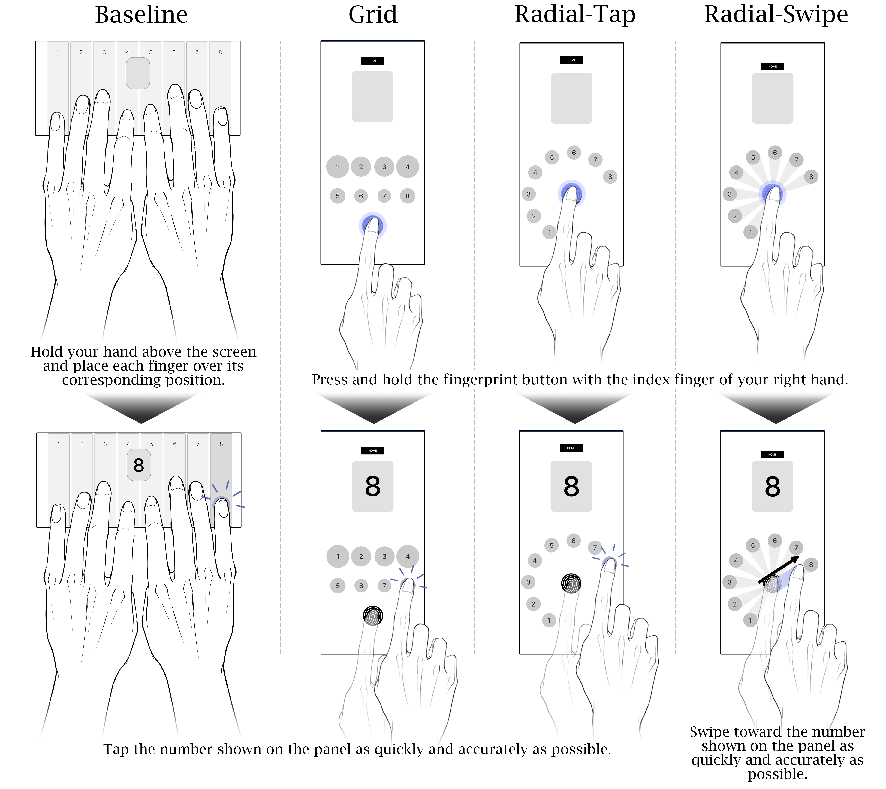

<div align="center">

<h1>HickStudy</h1>

<p><i>How Response Interfaces Shape Mobile Information Processing Speed Assessment</i></p>

[Quick Start](#quick-start) · [Experimental Design](#experimental-design) · [Data Schema](#data-schema)

</div>

---

> **Submitted for peer review.** Author names, affiliations, and the publication DOI
> are withheld while this work is under anonymous review.

## Overview

HickStudy compares four interfaces using a common numeric choice task with a
test–retest, and contributes empirical evidence and design implications for treating
the response interface as part of the measurement procedure, with score
interpretation and repeatability evaluated for each implementation.

IPS is defined as the reciprocal of the Hick regression slope:

```
RT = a + b · log2(N)          IPS = 1000 / b   (bit/s)
```

### The Four Interfaces

<div align="center">

<br>
<sub><b>(a) <i>Baseline</i></b></sub>

<br><br>

<table>
<tr>
<td align="center" width="33%">
  <br>
  <sub><b>(b) <i>Grid</i></b></sub>
</td>
<td align="center" width="33%">
  <br>
  <sub><b>(c) <i>Radial-Tap</i></b></sub>
</td>
<td align="center" width="33%">
  <br>
  <sub><b>(d) <i>Radial-Swipe</i></b></sub>
</td>
</tr>
</table>

</div>

|  | Interface | Response scheme |
| --- | --- | --- |
| **(a)** | **Baseline** | Fingers rest on choices; select on stimulus |
| **(b)** | **Grid** | Hold origin → release → tap |
| **(c)** | **Radial-Tap** | Hold origin → release → tap |
| **(d)** | **Radial-Swipe** | Hold origin → swipe toward target |




---

## Repository Contents

```
hick-public/
├── Assets/
│   ├── Scenes/                     # Experimental conditions and session flow
│   │   ├── main.unity              # Participant registration and condition launcher
│   │   ├── hick.unity              # Baseline (piano-key layout, both hands, no origin button)
│   │   ├── Length_5.unity          # Grid (iso-ID target sizing, direct tap)
│   │   ├── right_r.unity           # Radial-Tap (hold → release → tap)
│   │   ├── right_r_s.unity         # Radial-Swipe (hold → swipe)
│   │   └── fin.unity               # End-of-session screen
│   └── Script/                     # Experiment logic, layouts, logging
│       └── Editor/                 # .env → Firebase config generator, APK build
├── ProjectSettings/                # Unity project configuration
├── Packages/                       # Unity package manifest
├── .env.example                    # Template for your Firebase connection values
└── LICENSE                         # Academic and research use only
```

| Path | Description |
| --- | --- |
| `Assets/Scenes/` | One scene per interface, plus registration and end screens. See [Experimental Design](#experimental-design). |
| `Assets/Script/` | Trial loop, timing instrumentation, response layouts, Fitts models, and Firestore persistence. See [Source Files](#source-files). |
| `.env.example` | Template for the Firebase values each user sets in their own `.env`. See [Firebase](#2-firebase). |
| `LICENSE` | Academic and research use terms. |

### Source Files

| File | Description |
| --- | --- |
| `HickExperiment.cs` | Core apparatus: trial loop, stimulus timing, response capture, per-trial logging |
| `ExperimentConfig.cs` | Participant state and per-participant randomization of interface order |
| `FittsLawModel.cs` | Shannon and FFitts index-of-difficulty formulations, iso-ID target sizing |
| `FirestoreService.cs` | Session document creation and batched per-trial writes |
| `NumberButtonSpawnerBase.cs` | Layout interface shared by all response layouts |
| `SemiCircleButtonLayout.cs` | Radial layout used by Radial-Tap (`right_r`) and Radial-Swipe (`right_r_s`) |
| `GridNumberButtonLayout.cs` | Grid layout with iso-ID target sizing, used by Grid (`Length_5`) |
| `RhythmLaneButtonLayout.cs` | Piano-key layout, used by Baseline (`hick`) |
| `RadialSwipeSelector.cs` | Swipe-response detection for the Radial-Swipe interface |
| `FittsCalibrationExperiment.cs` | Standalone task for calibrating the FFitts finger-ambiguity constants |
| `Editor/FirebaseEnvConfig.cs` | Generates the Firebase config files from `.env` |
| `Editor/AndroidApkBuild.cs` | Builds `build/hick.apk` (**Tools → Build Android APK**) |
| `FpsProbe.cs` | Frame-rate logging, used to verify timing validity of a session |
| `MainSceneController.cs` | Registration form and condition launcher |

---

## Experimental Design

### Interfaces

Each interface is a Unity scene that plugs a different `NumberButtonSpawnerBase`
into the shared `HickExperiment` controller, so trial logic and timing
instrumentation are identical across interfaces. The paper refers to the four
interfaces by the names in the **Interface** column below; the **Scene** column is
the scene file that implements it.

| Scene | Interface | Response scheme |
| --- | --- | --- |
| `hick` | Baseline | Fingers rest on the choices; select on stimulus (no origin button) |
| `Length_5` | Grid | Hold fingerprint origin → release → tap target |
| `right_r` | Radial-Tap | Hold fingerprint origin → release → tap target |
| `right_r_s` | Radial-Swipe | Hold fingerprint origin → swipe toward target |

### Trial Structure

| Parameter | Value | Field in `HickExperiment` |
| --- | --- | --- |
| Number of alternatives | *N* = 1 … 8, blocked | `minN`, `maxN` |
| Trials per block | 10 | `trialsPerN` |
| Practice trials | 3 (at *N* = 8), logged separately and excluded from analysis | `practiceTrials` |
| Foreperiod before stimulus onset | Uniform 0.7 – 2.0 s | `minDelay`, `maxDelay` |

Interface order is randomized per participant with a Fisher–Yates shuffle over
`{ hick, Length_5, right_r, right_r_s }`
(`ExperimentConfig.BeginRightHandedAutoProgress`). Within each interface, the eight
*N* blocks are presented in randomized order.

## Architecture

```
Mobile Client (Unity, Android/iOS)
        │  participant registration
        ▼
Interface Scheduler (ExperimentConfig)
        │  Fisher–Yates shuffle over 4 interfaces
        ▼
Trial Loop (HickExperiment)
        │
        ├── Stimulus onset with 0.7–2.0 s uniform foreperiod
        ├── Response capture ── Piano-key / Grid / Radial layout
        ├── Timestamp decomposition ── onset / lift / touchdown (hold interfaces)
        └── Fitts metrics ── FittsLawModel (iso-ID sizing, Shannon + FFitts ID)
        ▼
Persistence (FirestoreService)
        │
        ├── Session document  ── test_info/{testId}
        └── Batched trials    ── test_info/{testId}/test_result/{autoId}
        ▼
Cloud Firestore (Anonymous Auth + App Check, write-only from client)
```

---

## Quick Start

### 1. Requirements

- **Unity 6000.2.10f1** (Unity 6.2) or compatible, with Android or iOS build support
- **Firebase Unity SDK 13.9.0** — App, Auth, Firestore, App Check
- A Firebase project (Spark tier is sufficient)
- An Android or iOS touchscreen device — editor play mode works for inspection but
does not reproduce touch timing

### 2. Firebase

The app stores its data in a Firebase project you own. No connection values are
committed to this repository: they live in a git-ignored `.env` file in the project
root, and Unity generates the config files the Firebase SDK needs from it.

**Set up your Firebase project**

1. Create a project at <https://console.firebase.google.com>.
2. In **Firestore Database**, create a database and paste the
   [security rules](#4-firestore-security-rules).
3. In **Authentication → Sign-in method**, enable **Anonymous**.
4. In **Project settings → General → Your apps**, register an Android app with the
   package name `com.hfm.hickstudy` and download `google-services.json`. If you register
   a different name, set the same one in **Player Settings → Other Settings → Package
   Name**. For iOS, also register the bundle ID `com.hfm.hickstudy.app` and download
   `GoogleService-Info.plist`.

**Connect the app**

5. Copy the template to `.env` in the project root:

   ```bash
   cp .env.example .env
   ```

6. Replace the values in `.env` with your own. For example:

   ```dotenv
   FIREBASE_PROJECT_ID=my-project-id
   FIREBASE_PROJECT_NUMBER=123456789012
   FIREBASE_STORAGE_BUCKET=my-project-id.firebasestorage.app

   FIREBASE_ANDROID_PACKAGE_NAME=com.hfm.hickstudy
   FIREBASE_ANDROID_APP_ID=1:123456789012:android:0a1b2c3d4e5f6a7b8c9d0e
   FIREBASE_ANDROID_API_KEY=AIzaSy...

   FIREBASE_IOS_BUNDLE_ID=com.hfm.hickstudy.app
   FIREBASE_IOS_APP_ID=1:123456789012:ios:0a1b2c3d4e5f6a7b8c9d0e
   FIREBASE_IOS_API_KEY=AIzaSy...

   FIREBASE_REPORT_URL=
   ```

   | `.env` key | Where to find it |
   | --- | --- |
   | `FIREBASE_PROJECT_ID` | `project_info.project_id` in `google-services.json` |
   | `FIREBASE_PROJECT_NUMBER` | `project_info.project_number` |
   | `FIREBASE_STORAGE_BUCKET` | `project_info.storage_bucket` |
   | `FIREBASE_ANDROID_PACKAGE_NAME` | `client_info.android_client_info.package_name` |
   | `FIREBASE_ANDROID_APP_ID` | `client_info.mobilesdk_app_id` |
   | `FIREBASE_ANDROID_API_KEY` | `api_key.current_key` |
   | `FIREBASE_IOS_BUNDLE_ID` | `BUNDLE_ID` in `GoogleService-Info.plist` (iOS builds only) |
   | `FIREBASE_IOS_APP_ID` | `GOOGLE_APP_ID` (iOS builds only) |
   | `FIREBASE_IOS_API_KEY` | `API_KEY` (iOS builds only) |
   | `FIREBASE_REPORT_URL` | Optional. Web page opened with `?testId=…` after a session; the page itself is not part of this repository. Leave empty to skip it. |

7. Open the project in Unity. `.env` is applied when the project loads and again before
   every build. If you edit it while the editor is open, run **Tools → Firebase → Apply
   .env**. A build stops with an error if a required value is missing or the package
   name does not match Player Settings.

> [!NOTE]
> `.env` keeps these values out of the repository, but they are still bundled into
> every build, as with any Firebase client app. They are **not** credentials: the
> backend is protected by Firestore security rules, Anonymous Authentication, and App
> Check. Never put an admin service-account key in `.env`.

### 3. Firebase Unity SDK

Import the App, Auth, Firestore and App Check `.unitypackage` files from
https://firebase.google.com/download/unity. The large desktop native libraries
(`FirebaseCppApp-*.bundle`, `*.so`) are git-ignored and regenerated on import.

### 4. Firestore Security Rules

Client writes require authentication; client reads are blocked, so the experimenter
reads collected data via the console or the Admin SDK. Paste into **Firestore → Rules**:

```
rules_version = '2';
service cloud.firestore {
  match /databases/{database}/documents {
    match /test_info/{testId} {
      allow create, update: if request.auth != null;
      allow read, delete: if false;
      match /test_result/{doc} {
        allow create: if request.auth != null;
        allow read, update, delete: if false;
      }
    }
  }
}
```

For data collection in the field, also enable **Firebase App Check** (Play Integrity)
and restrict the API key in the Google Cloud console.

### 5. Run a Session

Build with **Tools → Build Android APK**, install `build/hick.apk` on the device, and
launch. `main.unity` opens the registration form.

**On the registration screen:**

| Field | Enter |
| --- | --- |
| **NAME** | Participant number (e.g. `P01`) — do not enter a real name |
| **BIRTH DATE** | Date of birth as 8 digits, `YYYYMMDD`|
| **SEX** | `male` or `female` |
| **TYPE** | `auto` |

Then press **RIGHT** to arm the auto-sequence, and **SELECT** to begin. The
sequence runs all four interfaces in randomized order.

To run one interface on its own — useful for piloting, but not the protocol used in
the study — press **ETC** instead and pick the interface name under **TYPE**
(`Baseline`, `Grid`, `Radial-Tap`, `Radial-Swipe`).

**What happens next:**

```
1. Each interface shows its name, then runs 3 practice trials at N = 8
2. Blocks of 10 trials for N = 1 … 8, in randomized block order
3. Trials are batch-written to Firestore at the end of each block
4. The next interface loads automatically until all four are done
5. fin.unity is shown when the sequence completes
```

---

## Data Schema

### Session — `test_info/{testId}`

| Field | Type | Description |
| --- | --- | --- |
| `name` | string | Participant number as entered in **NAME** |
| `age` | int | Date of birth as `YYYYMMDD` (the field is named `age` for historical reasons) |
| `sex` | string | `male` or `female` |
| `type` | string | `Right-Handed Auto-Sequence` for an `auto` run, otherwise the interface label |
| `scene_name`, `scene_title` | string | Scene and its display title |
| timestamps | timestamp | Session start and update times |

### Trial — `test_info/{testId}/test_result/{autoId}`

| Field | Type | Description |
| --- | --- | --- |
| `trial_no` | int | Trial index within the interface |
| `block_no` | int | Block index; `0` = practice, main blocks start at 1 |
| `trial_in_block` | int | Trial index within the block |
| `n_value` | int | Number of alternatives *N* (1–8) |
| `target` | int | Presented stimulus |
| `pressed` | int | Response |
| `accuracy` | bool | `pressed == target` |
| `reaction_ms` | long | Stimulus onset → touchdown, in ms |
| `ips` | float | Per-trial index log2(*N* + 1) / RT, in bit · s⁻¹. **Not the reported IPS** |
| `input_mode` | string | Response scheme used on this trial |
| `is_practice` | bool | Practice trial flag |
| `phase` | string | `"practice"` or `"main"` |
| `created_at` | timestamp | Server-side write time |
| `stimulus_onset_ts` | double | Raw stimulus onset, monotonic clock, ms |
| `lift_ts` | double | Movement onset — fingerprint release (hold interfaces) |
| `touchdown_ts` | double | Target touchdown |
| `decision_ms` | double | `lift_ts − stimulus_onset_ts` |
| `movement_ms` | double | `touchdown_ts − lift_ts` |
| `touch_x`, `touch_y` | float | Touchdown point in canvas-local coordinates |
| `amplitude_mm` | float | Movement amplitude *A* |
| `target_width_mm` | float | Target width *W* |
| `fitts_id_baseline` | float | Shannon index of difficulty |
| `fitts_id_ffitts` | float | FFitts-corrected index of difficulty |
| `fitts_model` | string | `FittsSizingModel` that produced the sizing |

> [!WARNING]
> **The reported IPS is the reciprocal of the Hick regression slope**, fit as
> `RT = a + b · log2(N)` over *N* = 1…8 per participant × interface × session, with
> `IPS = 1000 / b`. The per-trial `ips` field is a convenience value only. 

## Data Availability

This repository contains the collection software only. **No participant data is
included**, and the app writes nothing to disk that identifies a participant beyond
the identifiers entered on the registration screen.

The trial-level dataset analysed in the paper is withheld during anonymous review
and will be deposited in a public repository, with its DOI recorded here, upon
publication.